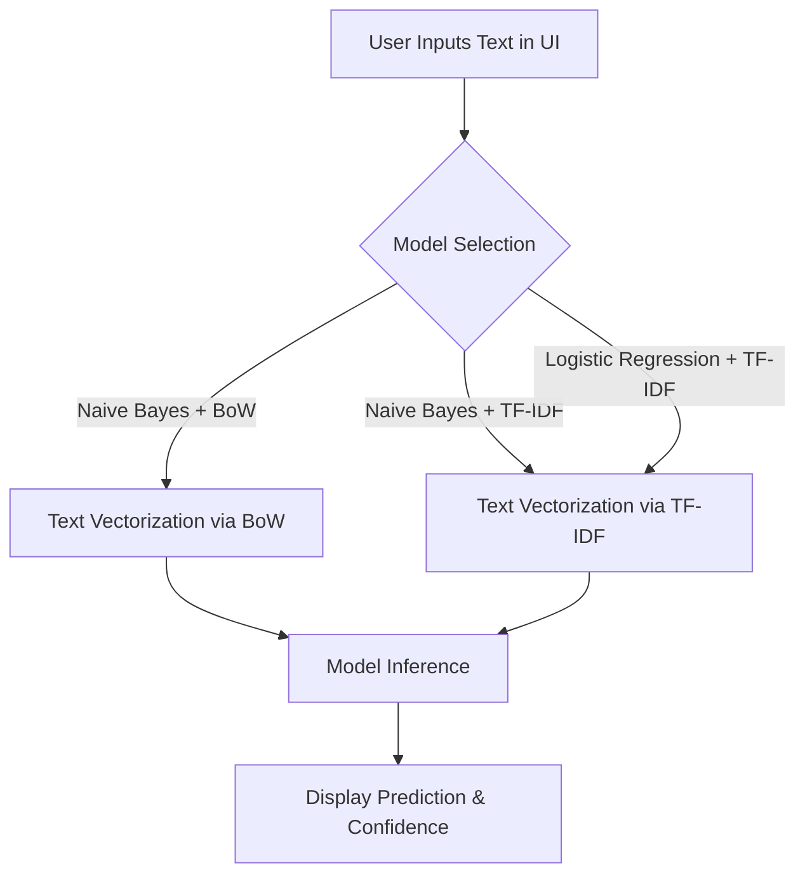

<div align="center">
  
  <h1>🧠 NLP Using ML Models: Interactive Streamlit UI</h1>
  <p><i>An elegant, interactive showcase of Text Classification models using Bag of Words & TF-IDF vectorization techniques alongside Naive Bayes and Logistic Regression algorithms.</i></p>

  
  
  
  
</div>

## 📖 Project Overview

This project provides a clean, modern user interface to explore different classical Machine Learning models utilized for Natural Language Processing (NLP) tasks. It helps you understand the theoretical differences, advantages, and real-world accuracy of these algorithms on text classification.

## 📊 Models at a Glance

The application is bifurcated by the models included. Here's a quick comparison:

| Classifier | Vectorizer | Accuracy | Best Use Case |
| :--- | :--- | :--- | :--- |
| **Logistic Regression** | TF-IDF | 🏆 **86.15%** | Complex text classification prioritizing accuracy |
| **Naive Bayes** | Bag of Words (BoW) | **76.78%** | Quick baseline models, simple categorization |
| **Naive Bayes** | TF-IDF | **66.09%** | Tasks requiring identification of rare, specific keywords |

## 🏗️ Architecture & Flow



*(Note: The current iteration focuses on UI and model structural demonstration, using simulated prediction outputs)*

## 🚀 Getting Started

Follow the instructions below to get this project running on your local machine. 

### 1. Clone the repository

```bash
git clone https://github.com/Rohit-more-05/NLP-using-ML-models.git
cd NLP-using-ML-models
```

### 2. Set up Virtual Environment

It is highly recommended to run this project in an isolated virtual environment.

```powershell
# Create virtual environment
python -m venv venv

# Activate it (Windows)
.\venv\Scripts\activate.ps1
```

### 3. Install Dependencies 📦

Depending on your Python package manager, you can install the requirements using standard `pip` or the ultra-fast `uv pip`.

> ⚠️ **Note:** Some users may have `uv` installed for faster dependency resolution. If you don't have it, stick to the standard `pip` method!

**🟢 Method A: Using Standard `pip` (For everyone)**
```bash
pip install -r requirements.txt
```

**⚡ Method B: Using `uv pip` (For speed enthusiasts)**
```bash
# If you have uv installed, use this flag to zoom through installation:
uv pip install -r requirements.txt
```

### 4. Run the Streamlit App

```bash
streamlit run app.py
```

## ✨ Features
- **Sleek UI:** Dark mode aesthetic with beautiful metric cards and layouts.
- **Model Bifurcation:** Read deep dives into the pros and cons of using BoW vs TF-IDF.
- **Simulated Sandbox:** Try entering text to see how the system would handle data flow and predict classifications!

<br>
<div align="center">
  <i>Built with ❤️ using Python and Streamlit</i>
</div>
